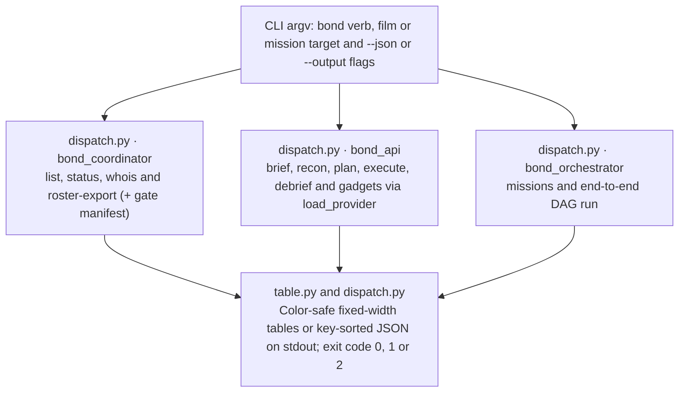

# Use bond-cli

## Command routing



**Source map:** [`dispatch.py`](../src/bond_cli/dispatch.py), [`table.py`](../src/bond_cli/table.py), [`manuscript_variables.py`](../src/bond_cli/manuscript_variables.py).

## The film/concept mapping

Every other package in the suite maps a *film* to software. This one maps the
*franchise's operational frame*: an operator receives a briefing, walks a
mission through its stages, runs a multi-part operation, and gets a status
board back. `bond-cli` is the desk that grammar happens at — one verb, one
target, one exit code — for all 27 films at once. Its own concept is the front
door itself: uniform access to heterogeneous capability, which is exactly what
a fleet of standalone packages otherwise lacks.

## Commands

| Command | Delegates to | Action |
|---|---|---|
| `bond list [--json]` | `bond_coordinator.registry` | print all 27 films (rank, slug, title, year, codename) |
| `bond brief <film>` | `bond_api` provider | print a film's `MissionBrief` |
| `bond recon <film> [goal]` | `bond_api` provider | print a film's recon findings |
| `bond plan <film>` | `bond_api` provider | print a film's `MissionPlan` steps |
| `bond execute <film>` | `bond_api` provider | execute a plan, print the `MissionOutcome` + provenance |
| `bond debrief <film>` | `bond_api` provider (`run_mission`) | run the full five-stage flow, print the `Debrief` |
| `bond run <mission>` | `bond_orchestrator` | run a canned mission end-to-end, consolidated debrief |
| `bond status [--json]` | `bond_coordinator.status` + gate manifest | suite-status snapshot (measured coverage when gated) |
| `bond gadgets [film]` | `bond_api.registry.GadgetRegistry` | list gadget-payload names (one film or the fleet) |
| `bond missions [--json]` | `bond_orchestrator.missions` | list canned missions + package chains |
| `bond whois <film> [--json]` | `bond_coordinator.registry` + gate manifest | registry identity, built-on-disk, measured state |
| `bond roster-export [--output PATH]` | `bond_coordinator.registry` + gate manifest | fleet roster as key-sorted JSON |

`list`/`status`/`missions`/`whois` accept `--json`; `roster-export` is JSON by
construction. Human tables are color-safe (fixed-width alignment, no ANSI).

**Exit codes:** `0` success · `1` command failure (unknown/broken film, non-passing
execute/debrief/run, empty or broken gadget lookup) · `2` argparse misuse or unknown
mission. All failure text goes to **stderr** — stdout on a failed command carries
only data. In particular `bond gadgets <film>` distinguishes three outcomes: an
unknown slug raises the same "not available" `CliError` as `brief`/`plan`, a
built-but-broken film is diagnosed to stderr (naming the exception) while still
contributing 0 so a whole-fleet sweep never aborts, and a clean film with no
gadgets keeps the empty-lookup message.

## The MissionProvider surface it consumes

`bond-cli` is the fleet's pure *consumer* of the frozen `bond-api` contract. It
reads exactly these members and never extends them:

| Stage | Call | Fields read |
|---|---|---|
| brief | `provider.brief()` | `film`, `codename`, `objectives`, optional `assets`, `constraints` |
| recon | `provider.recon(ReconRequest(goal=...))` | `findings[].label`, `.detail` |
| plan | `provider.plan(brief)` | `steps[].name`, `.action` |
| execute | `provider.execute(plan)` | `success`, `results`, `provenance` |
| debrief | `bond_api.protocol.run_mission(provider, request)` | `outcome`, `lessons` |
| gadgets | `bond_api.registry.GadgetRegistry` | `register`, `lookup`, `gadgets_for`, `films` |

Films are located through `bond_api.discovery.load_provider` over
`<bond root>/<slug>/src` and `<bond root>/bond-api/films`. Gadget discovery
tolerates every registration convention the fleet uses (hook arities, a module
`GADGETS` dict or factory, a module-level `GadgetRegistry`, provider-bound
registration); a film that fails to import contributes zero rather than
aborting a fleet-wide sweep.

## Run commands

From the [configured checkout](standalone.md), the installed `bond` command
and `scripts/bond.py` expose the same interface.

```sh
uv run --no-sync bond list
uv run --no-sync bond status --json
uv run --no-sync bond missions
uv run --no-sync bond roster-export --output /tmp/roster.json
```

The [standalone guide](standalone.md#reference-provider) shows how to inspect
the SABLE contract demonstration.

## Modules

| Path | Description |
|---|---|
| `src/bond_cli/__init__.py` | Package identity; assigns `__version__` before submodule import (the `{{PACKAGE_VERSION}}` fallback) |
| `src/bond_cli/dispatch.py` | The front door: command registries, twelve `cmd_*` handlers, film loading, gate-manifest reconciliation, tolerant gadget harvest, argparse surface, `main() -> int` |
| `src/bond_cli/table.py` | `format_table` — fixed-width, ANSI-free, byte-stable table rendering |
| `src/bond_cli/manuscript_variables.py` | `{{TOKEN}}` map from `docs/manuscript/config.yaml` + the coordinator/orchestrator/dispatch registries; persists `output/variables/manuscript_variables.json` |
| `scripts/bond.py` | Thin `sys.path` bootstrap → `dispatch.main` |
| `scripts/z_generate_manuscript_variables.py` | Thin orchestrator → `manuscript_variables.generate_variables` |

## Dependencies (all built, wired via pyproject `[tool.uv.sources]` path sources)

- `bond-utilities` (Q-BRANCH) — ciphers, codenames, clocks, deterministic RNG; loaded transitively by film providers
- `bond-api` (THE PROTOCOL) — frozen `MissionProvider` contract, discovery, `GadgetRegistry`
- `bond-coordinator` (MISSION CONTROL) — the roster (`ROSTER`) and suite status
- `bond-orchestrator` (DAG 00) — canned missions, `MissionRunner`, film adapters
